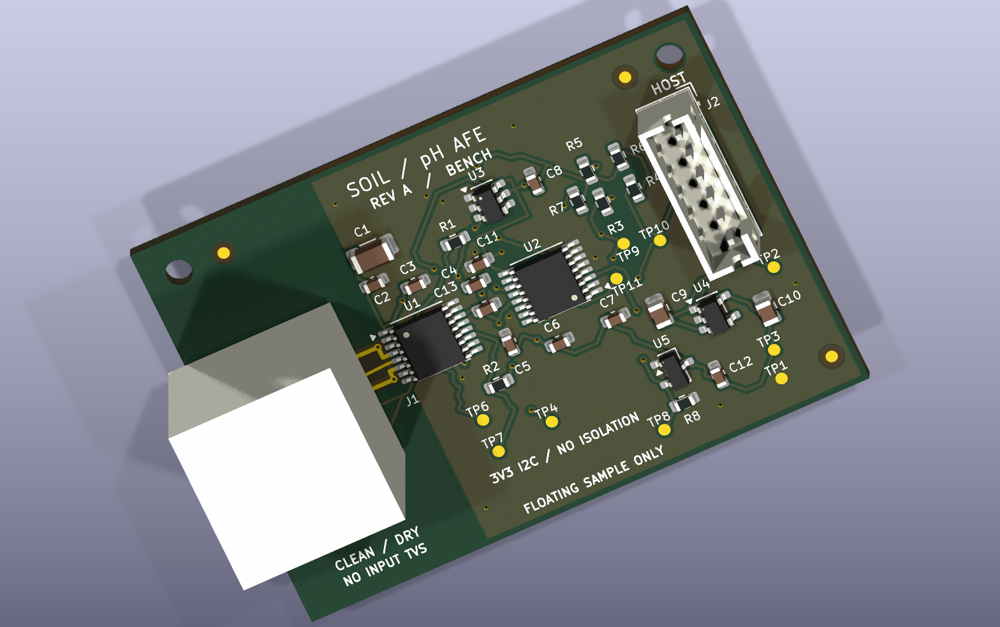

# Guarded pH Acquisition Module

**Rev A · engineering prototype · CAD reviewed 21 October 2026 · unbuilt / hardware validation pending**

A 50 × 35 mm, two-layer pH analog front end for an external ESP32-S3 host. The design combines an LMP91200 electrode buffer, ADS112C04 16-bit delta-sigma ADC, REF3220 2.048 V reference, and a quiet 3.3 V supply with delayed reference enable.

*CAD rendering, not a photograph. The BNC body is a drawing-derived clearance envelope, not a detailed vendor model.*

## Engineering focus

- Driven guards on both faces surround a 4.143 mm top-layer electrode trace with no vias or test-point stubs.
- Differential conversion at gain 2, external 2.048 V reference, and nominal 20 SPS single-shot mode; 31.25 µV per code. This is resolution, **not demonstrated accuracy**.
- Matched 1 kΩ input resistors and a 10 nF C0G differential capacitor; calculated pole 7.96 kHz.
- Supervisor-controlled reference startup, local test access, removable I²C pullups, and diagnostic/calibration firmware.
- Frozen project symbols and footprints; complete Gerber, drill, placement, and BOM outputs.

## Review status

Native KiCad 10.0.7 reports **0 ERC errors/warnings, 0 DRC violations, 0 unconnected pads, and 0 schematic-parity footprint errors**. A separate audit matches every native pad net and checks input geometry, copper exclusion, and via/paste separation. Generic analyzer findings and deliberate rule exceptions are explained in the [design review](docs/implementation/design_review.md).

The board has not been fabricated, assembled, powered, or tested. Leakage, noise, settling, startup, effective capacitor values, probe calibration, and interference remain hardware acceptance tests. The ≤0.01 pH electronics objective is an unproven target. There is no field ESD protection, onboard isolation, motor driver, battery system, radio, or cloud application.

## Files

| Deliverable | Location |
|---|---|
| Native KiCad project | [Soil_pH_AFE.kicad_pro](hardware/Soil_pH_AFE/Soil_pH_AFE.kicad_pro) |
| Schematic PDF | [schematic.pdf](output/review/schematic.pdf) |
| Fabrication package | [Rev A Gerber/drill ZIP](output/Soil_pH_AFE_RevA_fabrication.zip) |
| Fabrication and assembly instructions | [fabrication_notes.md](docs/implementation/fabrication_notes.md) |
| Orderable board BOM / host mating parts | [BOM.csv](output/assembly/BOM.csv) / [mating_parts.csv](output/assembly/mating_parts.csv) |
| Assembly drawing / placement | [assembly_top.pdf](output/assembly/assembly_top.pdf) / [placement_smd.csv](output/assembly/placement_smd.csv) |
| Firmware / bring-up | [Arduino sketch](firmware/SoilPH_Bringup/SoilPH_Bringup.ino) / [bringup.md](docs/implementation/bringup.md) |
| Review and decisions | [design_review.md](docs/implementation/design_review.md) / [decisions.md](docs/implementation/decisions.md) |
| Architecture and calculations | [Architecture](docs/architecture/01_architecture.md) / [calculations.json](docs/architecture/calculations.json) |
| Release hashes | [SHA256SUMS.txt](output/SHA256SUMS.txt) |
| Tools and reproducibility | [tools.md](docs/implementation/tools.md) |

## Scope and integration

This is an independent bench prototype based on an incomplete soil-instrument brief. Original Altium files and the promised replacement schematic were unavailable. The design therefore implements the requested analog chain on a separate board; it does not claim to preserve or reproduce the original product. Original client screenshots are retained locally and excluded from the public repository; the architecture contains the technical requirement summary.

Supply J2 with regulated 4.75–5.25 V and use 3.3 V open-drain I²C. J2: **1 = +5 V, 2 = ground, 3 = SDA, 4 = SCL, 5 = ground, 6 = reserved/unconnected**. Confirm pin 1 on the assembly drawing; do not infer it from viewing the cable end.

The insulated BNC shell is driven at approximately 1.024 V (`PH_VCM`); **it is not ground**. Use only a floating sample with no other conductive connection. Product integration requires a separately qualified isolated power and I²C interface, plus connector protection with a measured leakage budget. See [bring-up](docs/implementation/bringup.md) before applying power.

Phase 1 documents are retained as historical planning; final implementation decisions and BOM take precedence. Design/review used [kicad-happy](https://github.com/aklofas/kicad-happy) and routing used [KiCadRoutingTools](https://github.com/drandyhaas/KiCadRoutingTools), with manual protection of the high-impedance input and guard. Architecture was developed with Astra and implementation with 6.1 Sol; automated checks do not replace physical engineering qualification.
