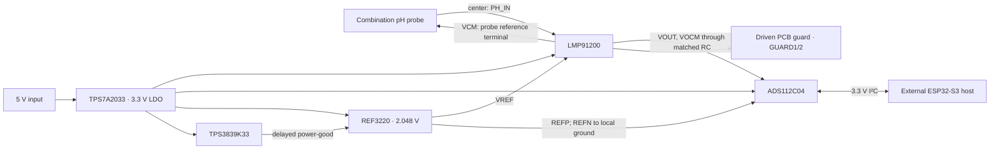

# Proposed architecture

Status: architectural design proposal; no circuit or hardware has been built or tested.

## Scope and operating assumptions

Build a pH acquisition module first. Keep the ESP32-S3, motor driver, battery/charger and switching converters off this board. This allows the specified analog chain to be evaluated without inventing the missing product. A later complete product board must recover or explicitly replace the missing original design requirements.

Proposed engineering targets, **not customer-supplied specifications**:

| Parameter | Phase 2 prototype target |
|---|---|
| Electrode | Passive, two-terminal combination pH electrode; assumed insulated BNC connection |
| Electrode potential | −600 to +600 mV relative to its reference terminal |
| Source resistance for validation | Up to 1 GΩ |
| Intended sample temperature | 0–50°C; separate measurement of actual sample temperature |
| Operating environment | Dry bench; humidity qualification required before field use |
| Supply | Regulated 5 V ±5%, current limited; allocate at least 50 mA at connector |
| Logic | 3.3 V I²C, initially 100 kHz, short local cable |
| Acquisition | 20 samples/s raw; one-second display average, preserve raw records |
| Electronics acceptance objective | ≤0.01 pH equivalent residual after electrical calibration at 25°C |
| Complete probe/sample accuracy | To be established experimentally; not implied by ADC resolution |

No battery-life, motor current, environmental ingress, safety-isolation rating or original-board dimension is assumed.

## Signal and power structure



The probe center conductor goes only to `PH_IN`. Its BNC shell/reference conductor goes to `PH_VCM`, **not ground and not GUARD**. The board guard follows the measuring input and is distinct from the electrode reference conductor. A triax probe would need a separately specified connector/pin mapping.

### Proposed net intent

These are implementation instructions, not an extracted or ERC-checked netlist. Verify every symbol pin and footprint pad against the archived package datasheet before CAD acceptance.

| Element | Intended connections |
|---|---|
| U1 LMP91200, TSSOP-16 | 1/14=`+3V3_A`; 10/13/15/16=`GND_A`; 2/3 no-connect; 4/6=`PH_GUARD`; 5=`PH_IN`; 7=`VCMHI`, leave unconnected; 8=`PH_VCM`; 9=`REF_2V048`; 11=`PH_VOCM`; 12=`PH_VOUT` |
| U2 ADS112C04, TSSOP-16 | 1/2 address straps to ground; 3=`AFE_READY`; 4/5=`GND_A`; 6/7 unused AIN3/AIN2 to ground; 8=`GND_A`; 9=`REF_2V048`; 10=`ADC_N`; 11=`ADC_P`; 12/13=`+3V3_A`; 14=`ADC_DRDY_N`; 15=`I2C_SDA`; 16=`I2C_SCL` |
| U3 REF3220, SOT-23-6 | 1 ground force; 2 ground sense; 3=`AFE_READY`; 4=`+3V3_A`; 5 output sense; 6 output force. Sense at the ADC reference capacitor's terminals; all grounds remain one local domain |
| U4 TPS7A2033, SOT-23-5 | 1/3=`+5V_IN`; 2=`GND_A`; 4 no-connect; 5=`+3V3_A` |
| U5 TPS3839K33, SOT-23-3 | 1=`GND_A`; 2=`AFE_READY`; 3=`+3V3_A` |
| ADC input filter | `PH_VOUT` → 1 kΩ → `ADC_P`; `PH_VOCM` → 1 kΩ → `ADC_N`; 10 nF C0G between ADC_P and ADC_N |
| Optional RF filter sites | Two matched 470 pF C0G from ADC inputs to ground, initially DNP; populate only after noise/settling validation |

U1 decoupling: 10 µF, 1 µF and 100 nF by pin 1, with another 100 nF by pin 14. U2: 100 nF at each supply pin and local 1 µF bulk. U3: 100 nF input and 1 µF output at ADC reference load. U4: nominal 4.7 µF input/output, with effective output capacitance ≥1 µF across voltage/temperature. U5: 100 nF local. Choose MLCC voltage rating and package from effective-capacitance curves, not nominal value alone.

No TVS, generic clamp diode, LED, voltage divider, digital trace, test-point branch or filter capacitor is allowed directly on PH_IN without a leakage budget and measurement. The prototype has a controlled ESD-handling envelope; field connector protection is an unresolved release gate.

### Reference and startup

REF3220 is **2.048 V**, not 2.0 or 2.5 V. With this applied to U1 VREF, nominal VCM is 1.024 V. Reference force and sense terminals must all be connected correctly; using only the force output while leaving sense floating is invalid.

The current REF32xx datasheet requires ENABLE to remain below 0.7 V until its input reaches its minimum operating voltage for slow input ramps. Use U5's delayed, push-pull reset output as `AFE_READY` to enable U3 and release U2 reset. TPS3839K33's nominal threshold is **2.93 V**, not 3.3 V; its delay is 120–350 ms. A 100 kΩ pulldown on AFE_READY controls the earliest ramp interval. [REF32xx §6.1.1; TPS383x §§6.5–6.6](06_sources.md)

The 3.3 V rail is at least 3.2505 V with the LDO's ±1.5% output bound. This leaves approximately 1.20 V above nominal REF3220 output and adequate supervisor release margin. The smallest falling threshold of 2.857 V remains well above the reference's approximately 2.10 V minimum supply. Brownout behavior and very slow ramps still require measurement.

Firmware waits at least 500 ms from stable module power, verifies configuration/reference diagnostics, then begins accepted readings. Reset release and reference enable happen together, so reset release alone does not prove that the reference has settled. The ADC uses its own power-on reset as well; U5 is not a replacement for firmware initialization.

Budget 10 mA for the core including bus lows, startup margin and component uncertainty; this is an allocation, not a characterized worst-case current. At 10 mA, U4 loss is (5−3.3)×0.010 = 17 mW. No power LED is planned. The module does not power the ESP32-S3.

## Conversion range and common-mode check

Use signed differential acquisition: `ADC_P − ADC_N ≈ probe potential`. Nominal values:

| Electrode potential | VOUT / AIN0 | VOCM / AIN1 | ADC input average |
|---|---:|---:|---:|
| −600 mV | 0.424 V | 1.024 V | 0.724 V |
| 0 | 1.024 V | 1.024 V | 1.024 V |
| +600 mV | 1.624 V | 1.024 V | 1.324 V |

Baseline total gain is 2. ADS112C04 implements gains 1/2/4 with an internal PGA gain of 1 and switched-capacitor gain. Its applicable input restriction is Equation 6, **0.2 V ≤ each input ≤ AVDD−0.2 V**. The frequently used generic gain-times-differential common-mode expression is not the appropriate rule for these settings. At minimum rail 3.2505 V, the upper bound is 3.0505 V; the closest nominal margin is 224 mV at the negative extreme. Allocate 10 mV to reference/VCM/offset uncertainty, leaving 214 mV preliminary margin. U1's precision buffer operating region also retains margin above its 300 mV characterization boundary. [ADS112C04 pp.23–24, Table 9/Eq.6; LMP91200 electrical characteristics](06_sources.md)

With gain 2 and a 2.048 V reference:

- Differential full scale = ±1.024 V, leaving 424 mV nominal range margin over ±600 mV.
- LSB = 2.048 / (2 × 32768) = 31.25 µV = 0.000528 pH equivalent at 25°C.
- Nominal one-sided full-scale count at +600 mV is 19,200.
- Gain 4 gives ±512 mV. Keep it as an optional characterized mode only; it can clip temperature/offset extremes even when ideal room-temperature pH 0–14 fits.
- The 1 kΩ + 1 kΩ / 10 nF differential input pole is about 7.96 kHz. It suppresses high-frequency energy; it does not itself provide a 10 Hz brick-wall anti-alias filter. Verify interference at modulator aliases and buffer settling experimentally.

These are calculations, not measured linearity/noise results. See `calculations.py` and `calculations.json`.

## Firmware contract

Start with single-shot mode, PGA enabled, gain 2, AIN0–AIN1, normal 20 SPS, external reference, temperature mode off, burnout/IDAC sources off. All address straps grounded gives seven-bit address 0x40.

Initial register image: register 0=0x02, register 1=0x02, register 2=0x00, register 3=0x00. Check readback; register 2 bit 7 is dynamic DRDY. Use ADC RESET/START/RDATA commands and manufacturer timing, not an ADS1115 driver. Conversion bytes are MSB then LSB; sign-extend the 16-bit result.

Poll DRDY in the register for the baseline interface. `ADC_DRDY_N` remains a local test point with 10 kΩ pullup; it need not cross an isolation barrier. A software reset command removes the need for another cross-barrier GPIO. After initial debugging, enable and verify CRC/counter features if the product's transport reliability requires them.

Log raw code, scaled millivolts, reference mode, gain, timestamp, sample temperature, calibration ID and status. Timeouts, bus errors, reference/supply diagnostic failures and saturation produce invalid data, not a clamped pH value. Burnout sources do not establish reliable probe-open detection behind a buffer; an open electrode may retain an apparently plausible voltage.

### Calibration and error allocation

Use a voltage simulator for electronics zero/gain calibration, then fresh pH buffers spanning the intended range. Derive slope and intercept from observed buffer readings; do not hard-code probe polarity without checking it. For buffer pairs `(pH1,E1)` and `(pH2,E2)`, use `pH = pH1 + (E−E1)(pH2−pH1)/(E2−E1)` at calibration temperature.

Ideal Nernst slope magnitude is approximately 59.16 mV/pH at 25°C and scales with absolute temperature. Record actual sample temperature using an external calibrated thermometer for the first build. The ADC's die-temperature sensor is not sample-temperature compensation. A later probe temperature interface is a separate requirement; no onboard RTD circuit is assumed.

| Contribution at 25°C, 1 GΩ source | Estimate/allocation | Meaning |
|---|---:|---|
| U1 input bias, ±125 fA bound | ±125 µV ≈0.00211 pH | Component contribution; rises with temperature |
| Additional board/connector leakage target | ≤100 fA →100 µV ≈0.00169 pH | Must measure after cleaning and humidity exposure |
| Reference initial ±0.2% at 600 mV | 1.2 mV ≈0.0203 pH | Before calibration; not an uncalibrated 0.01 pH design |
| Half-code quantization | 15.625 µV ≈0.000264 pH | Resolution only |
| Remaining calibrated error allowance | Offset/drift/filter loading/noise | Characterize; do not claim additive budget closure yet |

A 1 V contaminant-to-input gradient and 100 fA leakage target imply 10 TΩ insulation. This is why layout cleanliness is a functional requirement. Two-point calibration removes static gain/offset only; it cannot cure leakage drift, grounding errors, probe aging or sample-temperature uncertainty.

## Interface and isolation decision

Proposed J2 is a keyed six-position local interface; exact connector MPN remains a mechanical selection gate:

| Pin | Signal | Contract |
|---:|---|---|
| 1 | +5V_IN | 4.75–5.25 V regulated input |
| 2 | GND_A | Module ground |
| 3 | I2C_SDA | 3.3 V open drain |
| 4 | I2C_SCL | 3.3 V open drain |
| 5 | GND_A | Signal return |
| 6 | NC/key reservation | No external reset/data-ready connection required |

Use local 4.7 kΩ pullups with disconnectable links. At 100 pF, estimated 30–70% rise time is 0.8473×4.7k×100pF≈398 ns; at 200 pF, ≈796 ns. Measure actual capacitance/rise time, account for host pullups, and do not assume this supports 400 kHz. The host must not drive pins while the module is unpowered. This is not a hot-plug or long-cable interface.

**Bench variant:** J2 connects directly to an external ESP32-S3. A floating solution container, insulated connector, and no other conductive connection to that sample are required. Never use a grounded coax signal generator as the electrode without accounting for its ground connection to the driven reference terminal.

**Recommended product retrofit:** preserve the isolated pH island:

```text
ESP32-S3 domain                  barrier                  pH domain
3V3_HOST, GND_HOST  ── ISO1540 I²C isolator ── 3V3_A, GND_A
5V_HOST             ── isolated power path ── 5V_ISO → LDO → 3V3_A
                   no ground or shield bridge
```

Use ISO1540 side 1 toward the ADC and side 2 toward the host, subject to both endpoints' low-level thresholds and the isolator's side-1 offset-voltage check. Give each side its own supply bypassing and pullups. Polling avoids extra signal channels. This is a candidate isolation architecture, not a completed isolation design.

If recovered original CAD exposes a suitable 5 V isolated rail, retain and qualify it, including minimum-load behavior, noise and spare capacity. If only 3.3 V isolated power exists, the 3.3 V LDO cannot simply be placed after it; redesign filtering/rail voltage or provide an isolated 5 V source. If the original ADuM5401 must be removed entirely, replace its power-isolation function with a separately selected isolated converter. Its unidirectional digital channels are not a drop-in bidirectional SDA isolator. [ADuM5401 and ISO1540 datasheets](06_sources.md)

Barrier spacing and rated insulation cannot be assigned from the screenshots. The new converter and connector placement depend on original rails, sample grounding, working voltage, EMC requirements and enclosure. Do not approve any conductive bypass of the barrier until those inputs are resolved.
